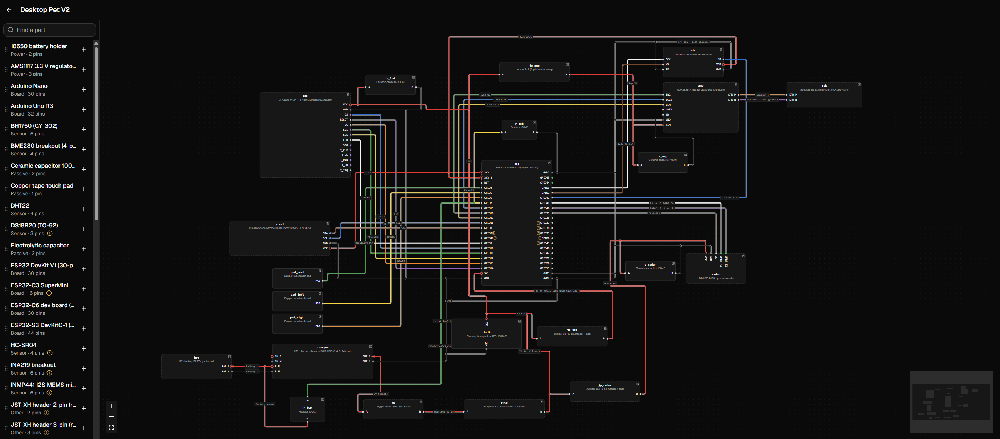
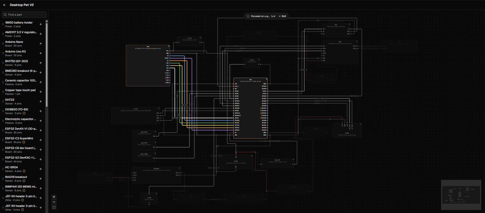
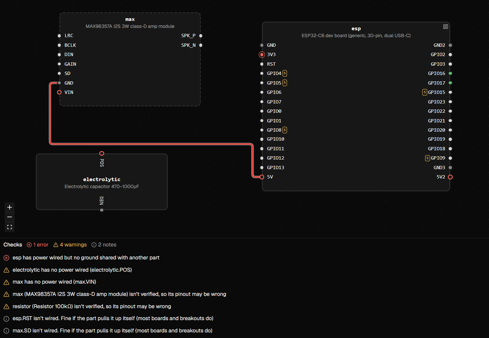
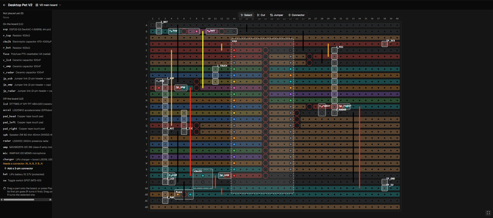
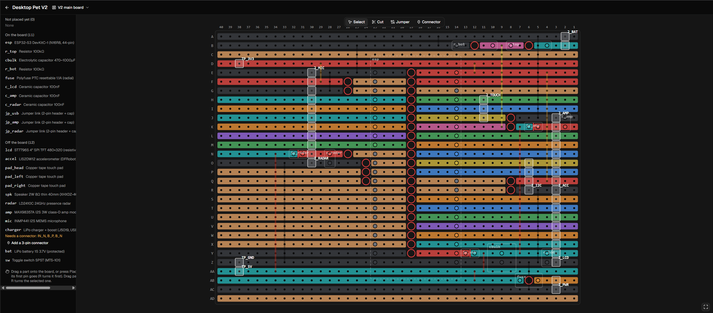

<p align="center">
  
</p>

# Ohm Sweet Ohm

A self-hosted electronics workbench for hobby builds made from off-the-shelf modules (ESP32 and Arduino boards, sensor breakouts, displays, relays). You keep a library of parts with their real pinouts, wire them together on a canvas, and the server checks the circuit for mistakes before you power anything up. From the same design it lays the circuit out on stripboard and generates firmware scaffolding.

Claude is built in as a collaborator over [MCP](https://modelcontextprotocol.io): it can read and review designs, build new ones, add parts from datasheets and lay circuits out on a board. It works on the same data as the UI, under the same rules.

It runs as a Home Assistant add-on and sits alongside its sibling app, Shelf-help, which tracks component stock and projects.

> This is a personal project. I build and maintain it alone, so I'm not accepting contributions. You're welcome to read the code.

Design canvas



Design canvas with component focus



Design canvas with rules engine



Design stripboard component side



Design stripboard copper side



## What it does

**Part library**
- Parts with pins, pin kinds (power, ground, GPIO, I2C, SPI, UART…), alternate functions, voltages, I2C addresses, datasheets, notes, tags and attachments
- Pin editor with header order and a live preview of the part card, plus a footprint editor in mm for board layouts
- A starter set of about 20 common modules, typed from the makers' pinouts
- Parts added by Claude stay *unverified* until checked against the real board, because a wrong pinout can kill a board

**Wiring designs**
- Drag-and-drop canvas (React Flow) with automatic wire routing, net highlighting, undo/redo and full revision history
- 17 server-side design rules. Some examples: 5 V reaching a 3.3 V pin, shorted supplies, SDA wired to SCL, two I2C devices at the same address, ESP32 strapping and flash pins, and ADC2 pins used while WiFi is on
- Suggested wiring for a newly placed part, based on what the board's pins can do
- Read-only view on phones

**Protoboard layouts**
- Stripboard and breadboard-pattern boards: place parts, cut tracks, add jumpers and connectors
- Live connectivity checks: shorts between nets, missing connections, parts off the edge and overlapping holes
- A printable 1:1 build sheet with numbered cuts and jumpers and the order of work

**Firmware from a design**
- `pins.h` / `pins.py` pin maps, a library-free Arduino bring-up sketch that tests the built circuit, and a `platformio.ini`
- A drift check that compares a firmware repo's pin map with the current design
- Export to Wokwi's `diagram.json` for simulation

**Claude over MCP**
- About 45 tools covering parts, designs, checks, layouts and firmware
- Guard rails are enforced on the server, not left to the prompt: no deletes through MCP, every change saves a revision first, free text is append-only, and parts Claude creates start out unverified
- Layouts are also described to Claude as a text picture of the board, so it can reason about holes and strips

## Architecture

| Layer | Stack |
|---|---|
| Backend | Python 3.12, FastAPI, SQLAlchemy 2, Alembic, Pydantic, SQLite |
| Frontend | React, TypeScript, Vite, Tailwind, shadcn/ui, TanStack Query, React Flow |
| API client | Generated from the OpenAPI spec with orval (no hand-written API types) |
| MCP | Official Python MCP SDK, streamable HTTP |
| Packaging | Multi-stage Docker image as a Home Assistant add-on, served through HA Ingress |
| Tests | pytest (≈200 tests), Vitest |

Design choices:
- **The connection list is the truth.** A design is placed parts plus pin-to-pin wires. The canvas is only a view of it, and nets and check results are always computed, never stored, so the UI and Claude can't drift apart.
- **The code is organised by feature** (`backend/app/modules/<feature>/`, `frontend/src/features/<feature>/`). Routers are thin and the business rules live in services.
- **Access is locked down by default.** The app is reachable only through Home Assistant Ingress, so HA handles login. The optional LAN port serves only `/mcp` and needs a random bearer token, compared in constant time. Trust is based on the connection's own address and never on forwarded headers.
- **Wire and pin data stay Wokwi-compatible**, so simulation export loses nothing.

Design docs live in [`docs/`](docs/): [overview](docs/project-overview.md), [data model](docs/data-model.md), [checks](docs/checks.md), [MCP](docs/mcp.md), [pages](docs/pages.md), [scope and decisions](docs/mvp.md).

## Running it locally

You need [uv](https://docs.astral.sh/uv/) and Node 24.

```bash
cd backend && uv sync && uv run alembic upgrade head
cd backend && uv run uvicorn app.main:create_app --factory --reload --port 8097
cd frontend && npm install && npm run dev   # http://localhost:5174
```

Run the tests with `cd backend && uv run pytest` and `cd frontend && npm test`.

To build and run the add-on image:

```bash
podman build -t ohm-sweet-ohm .
podman run --rm -p 8097:8097 -v ./.data:/data -e OHM_TRUSTED_CLIENTS='["0.0.0.0/0"]' ohm-sweet-ohm
```

To install it on Home Assistant, clone the repo into `/addons` and install it from **Settings → Add-ons → Add-on store → Local add-ons**.

## How it was built

I designed and directed this project and built it with Claude Code as a pair programmer. The specs in `docs/` and the rules in [`CLAUDE.md`](CLAUDE.md) came first, and they steered the work step by step.

## License

Copyright © 2026 Andre-Lois Swart. All rights reserved. The source is public to read, but no licence is granted to reuse it.